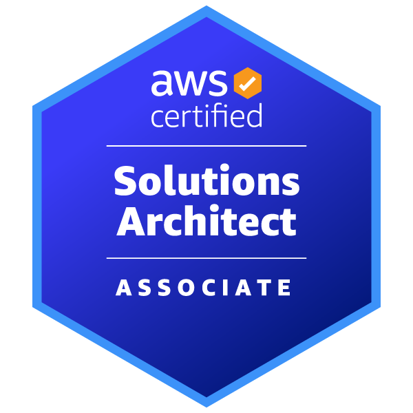

	

	<b>AWS Solutions Architect &amp; Cloud Engineer</b> designing <b>scalable, resilient, and secure cloud architectures</b>.

	<a href="https://www.eddux.dev">eddux.dev</a>
	·
	<a href="mailto:contact@eddux.dev">contact@eddux.dev</a>
	·
	<a href="https://www.linkedin.com/in/eduardodevts">LinkedIn</a>

---

## What I do

- **AWS Cloud Architecture**: Design secure, resilient, and cost-efficient solutions across the AWS ecosystem — compute, serverless, networking, IAM, storage, databases, messaging, observability, and more.
- **Infrastructure as Code**: Provision modular, multi-environment (`dev`, `qa`, `prod`) AWS and Cloudflare infrastructure with Terraform.
- **CI/CD & Operations**: Automate delivery pipelines with GitHub Actions and OIDC authentication, running containerized workloads on Docker and Linux.
- **Backend & Full-Stack**: Build APIs, authentication flows, and real-time services with TypeScript, Node.js, NestJS, WebSockets, and WebRTC.
- **Data & Messaging**: Work with relational and NoSQL databases, message queues, and distributed pipelines across PostgreSQL, DynamoDB, SQS, Kafka, and Spark.

## Featured projects

| Project | What it is | Stack | Status |
| :--- | :--- | :--- | :--- |
| **[Telar](https://telar-app.eddux.dev/)** | Platform for garment manufacturer operations management (quotes, production orders, tenancy, files, and auth). | AWS (ECS, Fargate, RDS, Cognito, ALB, API Gateway, S3, CloudFront, WAF) · Terraform · GitHub OIDC · NestJS · Next.js · PostgreSQL | **In Production** (Client project) |
| **[MeetOne](https://meetone.eddux.dev/)** | Real-time language exchange platform pairing users via serverless matchmaking and WebRTC connections. | AWS (Lambda, API Gateway, DynamoDB, Cognito) · Terraform · Cloudflare Calls · Vue 3 · WebRTC | **In Production** (Startup) |
| **[Tree Rings](https://github.com/devEddu17x/tree-rings-kafka-api)** | Distributed image processing system utilizing Kafka-triggered PySpark pipelines and CNN ring detection. | NestJS · Socket.IO · Apache Spark · Apache Kafka · Docker · OpenCV · Cloudflare R2 | **Lab Exploration** |

## Core stack

### Cloud & Infrastructure

### DevOps & Observability

### Backend & APIs

### Data & Messaging

*...and more across the AWS ecosystem (compute, networking, IAM, storage, messaging, observability) and backend tooling.*

## Certifications

	

---

## GitHub stats

	
	

	

	

